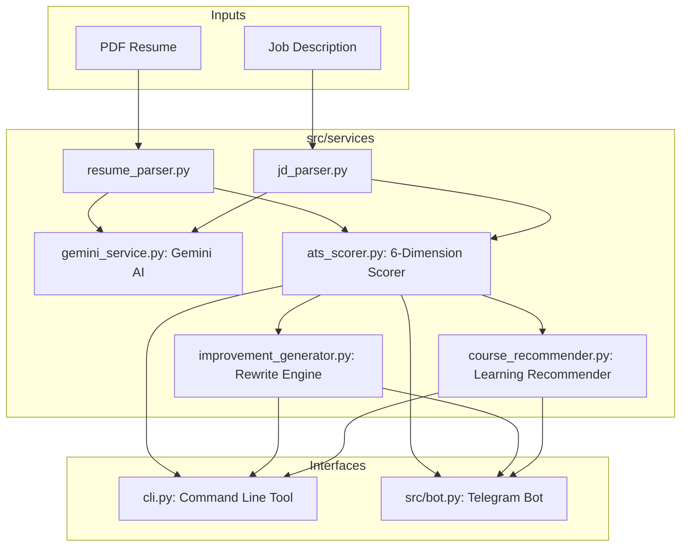

<div align="center">

# 🎯 AI Resume ATS Analyzer & Optimizer

**Production-grade Applicant Tracking System (ATS) scoring engine and Telegram Bot powered by Google Gemini.**

[](https://www.python.org/)
[](https://ai.google.dev/)
[](https://core.telegram.org/bots/api)
[](LICENSE)
[]()

<p align="center">
  Instant resume evaluation • 6-dimensional ATS match scoring • Actionable rewrite coaching • Personalized learning roadmaps
</p>

</div>

---

## 📌 Overview

Most job seekers get filtered out by Applicant Tracking Systems before a recruiter even reviews their resume. **AI Resume ATS Analyzer** simulates enterprise-grade ATS parsing algorithms to provide job applicants with deep, transparent feedback on how well their resume aligns with any target job description.

Built with **Python**, **Google Gemini**, and the **Telegram Bot API**, the system extracts semantic resume entities, matches requirements (including complex compound skills like *FastAPI or Flask*), computes an objective compatibility score (0–100), offers concrete bullet point transformations with strong action verbs, and recommends curated learning resources for identified skill gaps.

---

## 🚀 Key Features

- 📑 **Robust PDF Parsing**: Extracts text cleanly from PDF resumes without data corruption using `pypdf`.
- 🧠 **Structured Entity Extraction**: Uses Google Gemini to reliably extract structured entities (Skills, Work History, Education, Projects, and Certifications).
- ⚖️ **Dynamic 6-Dimensional Scoring (100 Pts)**:
  - **Required Skills Match (40 pts)**: Exact & semantic verification of mandatory job competencies.
  - **Preferred Skills Match (15 pts)**: Evaluation of bonus / nice-to-have qualifications.
  - **Experience Relevance (15 pts)**: Automatic tenure calculation vs. required minimum years.
  - **Education & Domain Fit (10 pts)**: Degree level and major alignment against job expectations.
  - **Resume Structure (10 pts)**: Section completeness and formatting compliance.
  - **Keyword Coverage (10 pts)**: Density and distribution of key domain vocabulary.
- 💡 **AI Resume Coach ("Before & After")**: Rephrases passive bullet points into impactful achievements with metrics and industry-proven action verbs.
- 📚 **Intelligent Learning Paths**: Combines a curated catalog of industry courses (Coursera, edX, Docker, AWS, Confluent) with dynamically generated learning links for novel skills.
- 🤖 **Interactive Telegram Bot**: Fast, asynchronous chat interface with inline buttons, message splitting for long reports, and typing indicators.
- 💻 **Standalone CLI Mode**: Evaluate any resume and job description directly from the command line for fast scripting and CI validation.

---

## 🏗️ Architecture



---

## 📁 Repository Structure

```text
resume-ats-bot/
├── src/
│   ├── config.py                 # Central configuration, scoring weights & paths
│   ├── bot.py                    # Production-grade Telegram Bot application
│   └── services/
│       ├── gemini_service.py     # Gemini client with fallback models & JSON schema mode
│       ├── resume_parser.py      # PDF text extractor & structured resume parser
│       ├── jd_parser.py          # Job description analyzer
│       ├── ats_scorer.py         # Dynamic 6-dimensional ATS scoring engine
│       ├── improvement_generator.py # Actionable AI resume coach (Before vs. After)
│       ├── course_recommender.py # Hybrid course recommender (curated + AI roadmaps)
│       └── report_generator.py   # Full Markdown ATS report generator
├── data/
│   └── curated_courses.json      # Structured database of verified courses & tutorials
├── samples/
│   ├── sample_resume.pdf         # Sample resume for verification
│   └── sample_jd.txt             # Sample job description
├── tests/
│   └── test_ats_pipeline.py      # Standard unittest end-to-end integration suite
├── .github/workflows/ci.yml      # Automated GitHub Actions CI workflow
├── Dockerfile                    # Containerization for 24/7 deployment
├── docker-compose.yml            # Docker Compose specification
├── bot.py                        # Telegram bot runner entrypoint
├── cli.py                        # CLI evaluation runner
├── requirements.txt              # Production dependencies
├── .env.example                  # Environment configuration template
└── README.md                     # Project documentation
```

---

## ⚙️ Quickstart & Setup

### 1. Prerequisites
- Python 3.10 or higher
- A [Google Gemini API Key](https://aistudio.google.com/)
- A [Telegram Bot Token](https://t.me/botfather) (if running the Telegram bot)

### 2. Installation

```bash
# Clone the repository
git clone https://github.com/<your-username>/resume-ats-bot.git
cd resume-ats-bot

# Create and activate virtual environment
python3 -m venv .venv
source .venv/bin/activate  # On Windows: .venv\Scripts\activate

# Install dependencies
pip install -r requirements.txt
```

### 3. Configure Environment Variables

Copy the sample environment file:
```bash
cp .env.example .env
```

Set your credentials in `.env`:
```ini
TELEGRAM_BOT_TOKEN="your_telegram_bot_token"
GEMINI_API_KEY="your_google_gemini_api_key"
GEMINI_MODEL="gemini-3.5-flash"
```

---

## 💻 Usage

### Option A: Run via CLI

You can evaluate any resume and job description right in your terminal, and optionally export a full Markdown report:

```bash
# Terminal evaluation
python cli.py --resume samples/sample_resume.pdf --jd samples/sample_jd.txt

# Evaluate and export formatted report file
python cli.py --resume samples/sample_resume.pdf --jd samples/sample_jd.txt --export ATS_Report.md
```

### Option B: Run the Telegram Bot

Start the Telegram polling daemon:

```bash
python bot.py
```

Then in Telegram:
1. Start the bot with `/start`.
2. Upload your resume as a **PDF document**.
3. Send the **Job Description** as a text message.
4. Receive your detailed report, match scores, improvement tips, and a **downloadable `.md` report document** directly in the chat!

### Option C: Run with Docker (Optional 24/7 Hosting)

Deploy the bot as a background container:

```bash
docker compose up -d
```

### Option D: Run Integration Tests

Run the complete pipeline test suite:

```bash
python -m unittest tests/test_ats_pipeline.py
```

---

## 📊 ATS Scoring Dimensions

| Dimension | Default Weight | Description |
| :--- | :---: | :--- |
| **Required Skills** | 40% | Mandatory technical competencies, libraries, and frameworks |
| **Preferred Skills** | 15% | Bonus qualifications and nice-to-have capabilities |
| **Experience** | 15% | Cumulative candidate tenure measured against minimum years required |
| **Education** | 10% | Degree level (Bachelor's, Master's) and relevance of field of study |
| **Resume Structure** | 10% | Section completeness (Skills, Experience, Education, Projects) |
| **Keyword Coverage** | 10% | Density of domain-specific terminology throughout resume text |

*All dimension weights can be tuned in `src/config.py`.*

---

## 🛡️ Resilience & Engineering Highlights

- **Model Fallbacks**: Handles Google Gemini high-demand spikes (503 / 429) automatically by cascading across candidate models (`gemini-3.5-flash` → `gemini-3.5-flash-lite` → `gemini-3.6-flash`).
- **Compound Skill Matching**: Understands alternative requirements (e.g. *"PostgreSQL or MySQL"*, *"FastAPI / Flask"*) without falsely marking them missing.
- **Word-Boundary Regex**: Prevents substring false positives for short programming languages like `C`, `R`, and `Go`.
- **Safe Session Management**: Uses native Telegram bot session states (`context.user_data`) with automatic temporary file cleanup.
- **Message Chunking**: Automatically partitions long reports into clean, multi-message deliveries to adhere to Telegram's 4,096-character limit.

---

## 📄 License

Distributed under the MIT License. See `LICENSE` for more information.
