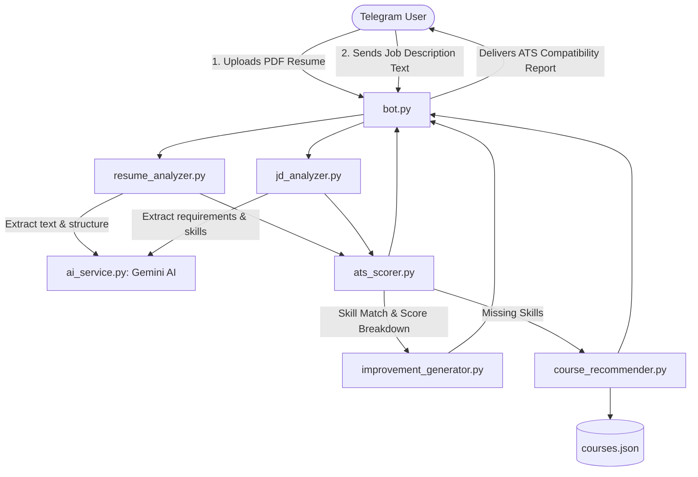

# 🤖 AI Resume ATS Analyzer & Telegram Bot

An intelligent, AI-powered Applicant Tracking System (ATS) bot built with **Python**, **Google Gemini**, and **Telegram Bot API**. It analyzes candidate resumes against job descriptions, computes an ATS compatibility score, detects skill gaps, recommends tailored resume improvements, and suggests curated learning courses.

---

## ✨ Features

- 📄 **PDF Resume Extraction**: Parses and analyzes raw text directly from PDF resumes using `pypdf`.
- 🧠 **AI Information Extraction**: Utilizes Google Gemini models to extract structured entities (skills, experience, education, projects, certifications).
- 🎯 **ATS Compatibility Scoring (100 Points Total)**:
  - **Required Skills Match**: 40 pts
  - **Preferred Skills Match**: 15 pts
  - **Experience Relevance**: 15 pts
  - **Education & Field Match**: 10 pts
  - **Resume Structure**: 10 pts
  - **Keyword Coverage**: 10 pts
- 🔍 **Skill Gap Analysis**: Identifies missing required skills vs. missing bonus/preferred skills.
- 💡 **Actionable Resume Improvements**: Produces role-targeted suggestions using strong action verbs without fabricating details.
- 📚 **Targeted Course Recommendations**: Maps skill gaps to curated courses and resources from Coursera, Udemy, YouTube, and official documentation.
- 💬 **Interactive Telegram Bot**: Clean chat interface with document handling, multi-part reports, session management (`/start`, `/help`, `/reset`), and error handling.
- 🛡️ **Resilient Architecture**: Centralized AI service with automatic model fallbacks (`gemini-3.5-flash`, `gemini-3.5-flash-lite`, etc.) and structured JSON responses.

---

## 🏗️ Architecture & Workflow



---

## 📁 Project Structure

```text
resume-ats-bot/
├── ai_service.py              # Centralized Gemini AI client with model fallback & JSON mode
├── ats_scorer.py              # Core ATS scoring algorithm & regex-based matching
├── bot.py                     # Telegram bot application & interaction handlers
├── course_recommender.py      # Skill gap to course mapping engine
├── courses.json               # Curated learning resources database
├── improvement_generator.py   # AI resume improvement generator
├── jd_analyzer.py             # AI job description entity extractor
├── job_description.txt        # Sample job description for testing
├── resume.pdf                 # Sample PDF resume for testing
├── resume_analyzer.py         # PDF text extractor & structured resume parser
├── test_pipeline.py           # End-to-end integration test runner
├── requirements.txt           # Python package dependencies
├── .env.example               # Environment variables template
├── .gitignore                 # Git ignore rules for virtualenvs and secrets
└── README.md                  # Project documentation
```

---

## 🚀 Getting Started

### 1. Prerequisites
- **Python 3.10+**
- A **Google Gemini API Key** (from [Google AI Studio](https://aistudio.google.com/))
- A **Telegram Bot Token** (from [@BotFather](https://t.me/botfather) on Telegram)

### 2. Clone the Repository
```bash
git clone https://github.com/<your-username>/resume-ats-bot.git
cd resume-ats-bot
```

### 3. Set Up Virtual Environment
```bash
python3 -m venv venv
source venv/bin/activate  # On Windows: venv\Scripts\activate
pip install -r requirements.txt
```

### 4. Configure Environment Variables
Copy the `.env.example` file to `.env`:
```bash
cp .env.example .env
```

Edit `.env` and set your credentials:
```ini
TELEGRAM_BOT_TOKEN="your_telegram_bot_token_here"
GEMINI_API_KEY="your_gemini_api_key_here"
GEMINI_MODEL="gemini-3.5-flash"
```

---

## 🧪 Testing the Pipeline

You can run the end-to-end test script without starting the Telegram bot:

```bash
python test_pipeline.py
```

This will:
1. Parse `resume.pdf`
2. Parse `job_description.txt`
3. Compute the ATS match score and breakdown
4. Generate AI improvement suggestions
5. Recommend tailored courses for missing skills

---

## 🤖 Running the Telegram Bot

Start the Telegram bot service:

```bash
python bot.py
```

Once running:
1. Open Telegram and search for your bot username.
2. Send `/start` to begin.
3. Send your resume as a **PDF document**.
4. Send your target **Job Description** as text.
5. The bot will reply with your complete ATS score report, missing skills, improvements, and course links!

---

## 📤 Uploading to GitHub

When you're ready to create a GitHub repository and push your code:

```bash
# 1. Initialize git (if not already initialized)
git init

# 2. Stage all clean project files
git add .

# 3. Verify that .env and venv are ignored
git status

# 4. Commit changes
git commit -m "feat: initial clean release of Resume ATS Analyzer Bot"

# 5. Create a new repository on GitHub (via GitHub web UI)
# Then link your remote and push:
git branch -M main
git remote add origin https://github.com/<your-username>/<your-repo-name>.git
git push -u origin main
```

---

## 📄 License
This project is open source and available under the [MIT License](LICENSE).
